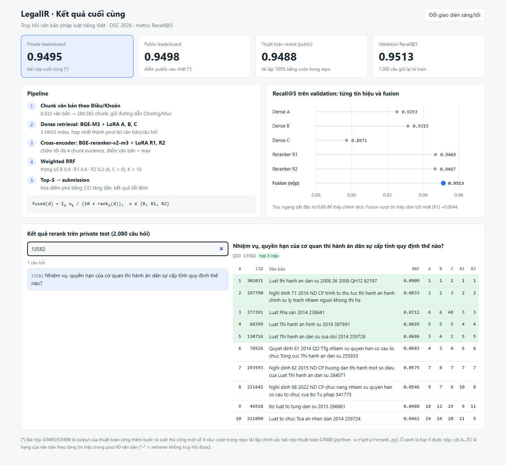
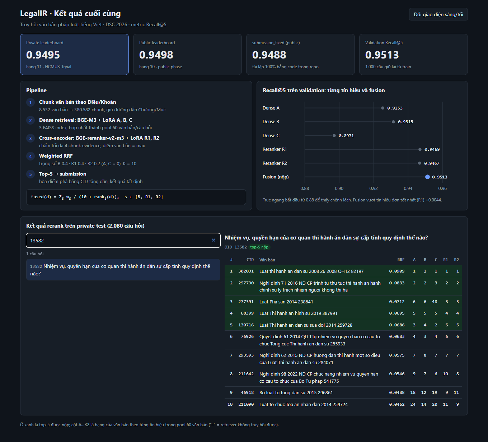
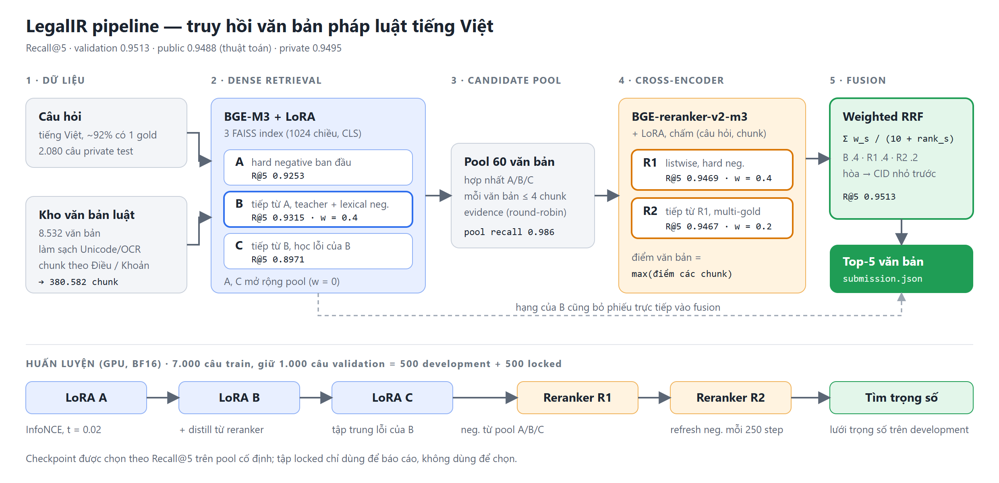
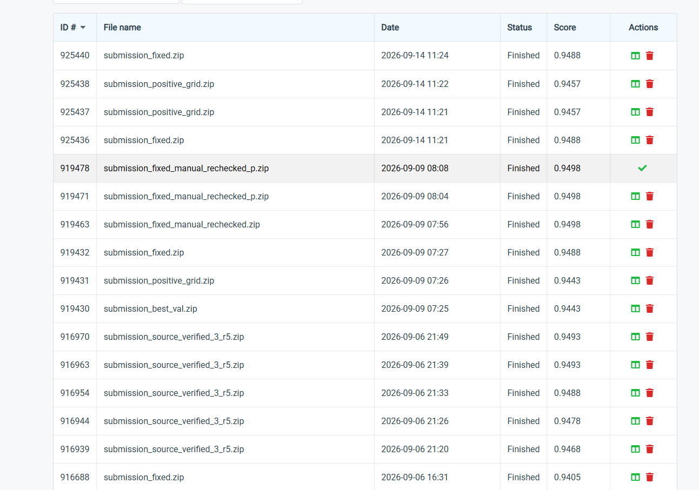
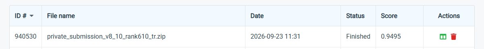

# Legal-Document-Retrieval

Hệ thống truy hồi văn bản pháp luật tiếng Việt cho cuộc thi **DSC 2026 – LegalIR**.
Với mỗi câu hỏi, hệ thống trả về 5 văn bản luật liên quan nhất; điểm chấm là **Recall@5**.

| | Điểm |
|---|---:|
| **Private leaderboard** (bài nộp cuối) | **0.9495** |
| Public leaderboard (cao nhất) | 0.9498 |
| Thuật toán rerank trong repo (public, tái lập 100%) | 0.9488 |
| Validation Recall@5 (1.000 câu giữ lại từ train) | 0.9513 |

> Bài nộp 0.9495 / 0.9498 là output của thuật toán cộng thêm bước rà soát thủ công một số ít câu.
> Code trong repo tái lập chính xác từng byte bài nộp thuật toán 0.9488.



<details><summary>Giao diện tối</summary>



</details>

## Phương pháp



Bản vector: [docs/images/pipeline.svg](docs/images/pipeline.svg)

1. **Chunk theo cấu trúc pháp lý** – làm sạch Unicode/OCR, cắt theo *Điều* (và *Khoản* khi Điều quá dài),
   mỗi chunk giữ đường dẫn Phần/Chương/Mục: 8.532 văn bản → 380.582 chunk.
2. **Dense retrieval** – 3 LoRA trên BGE-M3: A học từ hard negative ban đầu, B tiếp tục từ A với
   teacher/lexical negative, C tiếp tục từ B tập trung vào lỗi của B. Ba index FAISS được hợp nhất thành
   pool 60 văn bản cho mỗi câu hỏi.
3. **Cross-encoder rerank** – 2 LoRA trên BGE-reranker-v2-m3: R1 học listwise trên hard negative
   của ensemble dense, R2 tiếp tục từ R1 học multi-gold. Mỗi văn bản được chấm trên tối đa 4 chunk
   evidence, điểm văn bản = **max** các chunk.
4. **Thuật toán rerank cuối – Weighted Reciprocal Rank Fusion** ([legalir/rerank/rrf.py](legalir/rerank/rrf.py)):

   $$\text{fused}(d) = \sum_{s \in \{A,B,C,R1,R2\}} \frac{w_s}{\sum w} \cdot \frac{1}{10 + \text{rank}_s(d)}$$

   - `rank_s(d)`: hạng của văn bản trong pool theo tín hiệu `s` (hòa → CID nhỏ hơn đứng trước).
   - Retriever dense chỉ bỏ phiếu cho văn bản nó thực sự truy hồi được.
   - Trọng số nộp: `A=0, B=0.4, C=0, R1=0.4, R2=0.2`; top-5 theo `fused` là đáp án.
   - Trọng số được chọn trên tập development (500 câu); tập locked (500 câu) chỉ để báo cáo.

**Recall@5 trên validation (1.000 câu):**

| Dense A | Dense B | Dense C | Reranker R1 | Reranker R2 | **Fusion** |
|---:|---:|---:|---:|---:|---:|
| 0.9253 | 0.9315 | 0.8971 | 0.9469 | 0.9467 | **0.9513** |

## Cấu trúc thư mục

```
legalir/                   # package, tách từ file đơn ex9488.py thành 60 module nhỏ
├── core/                  # Config, Paths, hằng số, I/O, quản lý artifact
├── data/                  # đọc dữ liệu, làm sạch văn bản, chunk theo Điều/Khoản
├── models/                # BGE-M3 dense encoder, BGE-reranker, cấu hình LoRA
├── retrieval/             # FAISS index, hợp nhất ứng viên A/B/C
├── training/              # mine hard negative, train LoRA embedding và reranker
├── rerank/
│   ├── rrf.py             # ★ thuật toán rerank Weighted RRF (Python thuần, chạy CPU)
│   ├── fusion.py          #   bản vector hóa NumPy dùng khi train
│   ├── weight_search.py   #   tìm trọng số theo Recall@5 trên development
│   └── ...                #   chấm cross-encoder, cache, meta-ranker
├── evaluation/            # metric Recall@5 và hiệu chỉnh
├── experiment/            # train C từ B và R2 từ R1 (lớp Experiment ghép từ mixin)
├── pipeline/              # submission, kiểm cấu hình, dự đoán bằng model đã train
├── api.py                 # namespace phẳng thay cho `import ex9488 as api`
└── cli.py                 # python -m legalir ...
scripts/
├── rerank.py              # rerank file candidate → submission.zip (CPU)
└── build_dashboard_data.py
dashboard/                 # màn hình kết quả cuối (HTML tĩnh)
examples/                  # 3 câu hỏi mẫu kèm điểm 5 tín hiệu
tests/                     # 32 test CPU
```

## Cài đặt

```bash
git clone https://github.com/<username>/Legal-Document-Retrieval-.git
cd Legal-Document-Retrieval-
pip install -r requirements.txt        # pipeline đầy đủ (GPU)
```

Chỉ chạy thuật toán rerank / ví dụ thì **không cần cài gì thêm** ngoài Python ≥ 3.10.

## Ví dụ

### 1. Rerank 3 câu hỏi mẫu (CPU, ~1 giây)

```bash
python scripts/rerank.py --input examples/sample_candidates.jsonl --show
```

```
qid=13582 | Nhiệm vụ, quyền hạn của cơ quan thi hành án dân sự cấp tỉnh quy định thế nào?
  #1 cid=302031  rrf=0.090909  Luat thi hanh an dan su 2008 26 2008 QH12 82197
  #2 cid=297790  rrf=0.083333  Nghi dinh 71 2016 ND CP trinh tu thu tuc thi hanh an hanh chinh ...
  #3 cid=277391  rrf=0.071154  Luat Pha san 2014 238641
  #4 cid=68399   rrf=0.069524  Luat Thi hanh an hinh su 2019 387991
  #5 cid=130716  rrf=0.068571  Luat Thi hanh an dan su sua doi 2014 259728
...
Weights: {'a': 0.0, 'b': 0.4, 'c': 0.0, 'r1': 0.4, 'r2': 0.2}
Queries: 3 -> outputs/rerank/submission.zip
Top-5 khớp submission_answer trong file input: 3/3
```

Đổi trọng số: `--weights b=0.5,r1=0.5`.

### 2. Dùng thuật toán trong code

```python
from legalir.rerank.rrf import Candidate, rerank

pool = [
    Candidate("101", scores={"a": .81, "b": .80, "c": .83, "r1": 5.9, "r2": 5.4}),
    Candidate("202", scores={"a": .78, "b": .79, "c": .70, "r1": 3.1, "r2": 4.0}),
    Candidate("303", scores={"a": .75, "b": .77, "c": .00, "r1": 4.2, "r2": 2.2}, present={"c": False}),
    Candidate("404", scores={"a": .70, "b": .74, "c": .68, "r1": 1.0, "r2": 0.5}),
    Candidate("505", scores={"a": .69, "b": .71, "c": .66, "r1": 2.5, "r2": 3.3}),
]
print(rerank(pool))   # [('101', 0.090909...), ('202', ...), ('303', ...), ('505', ...), ('404', ...)]
```

### 3. Dự đoán file test mới bằng model đã train (GPU, Kaggle)

```bash
python -m legalir --stage loadmodel \
  --loadmodel-model-dir /kaggle/input/<run C/R2 đã train> \
  --cr2-source          /kaggle/input/<run nguồn A/B/R1> \
  --test-file           /kaggle/input/<...>/private-official.json \
  --loadmodel-output-dir /kaggle/working/legalir_private
```

Sinh `private_submission_{fixed,best_val,positive_grid}.zip` và file debug
`private_top20_fixed.jsonl` (điểm 5 tín hiệu + evidence). File debug này chính là input của
`scripts/rerank.py` và `scripts/build_dashboard_data.py`:

```bash
python scripts/rerank.py --input /kaggle/working/legalir_private/private_top20_fixed.jsonl
# Top-5 khớp submission_answer trong file input: 2080/2080
```

### 4. Huấn luyện

```bash
# Train C (tiếp từ B) và R2 (tiếp từ R1) trên run nguồn đã có A/B/R1 — cấu hình của bản 0.9488
python -m legalir --stage retrain-c-r2 --cr2-source <run nguồn> --work-dir runs/legalir_brepair

# Pipeline gốc từ đầu: chuẩn bị dữ liệu → A → B → C → R1 → R2 → hiệu chỉnh → dự đoán
python -m legalir --stage all --data "<thư mục LegalIR - Public Test>" --work-dir runs/legalir_bgem3
```

Yêu cầu GPU CUDA hỗ trợ BF16 (đã chạy trên RTX PRO 6000 96 GB). Xem mọi tham số: `python -m legalir -h`.

## Dashboard

Mở trực tiếp [dashboard/index.html](dashboard/index.html) trong trình duyệt. Trang hiển thị điểm cuối,
pipeline, Recall@5 từng tín hiệu và top-10 sau rerank của 2.080 câu hỏi private (tìm theo câu hỏi, QID, CID).
Dựng lại dữ liệu từ file debug:

```bash
python scripts/build_dashboard_data.py --input path/to/private_top20_fixed.jsonl
```

## Kiểm thử

```bash
pip install pytest
python -m pytest            # 32 test, CPU, không cần model
python -m legalir --self-test
```

## Leaderboard

Public:



Private:



## Dữ liệu

Dữ liệu cuộc thi, checkpoint LoRA và FAISS index không nằm trong repo (xem `.gitignore`).
Model gốc: [BAAI/bge-m3](https://huggingface.co/BAAI/bge-m3),
[BAAI/bge-reranker-v2-m3](https://huggingface.co/BAAI/bge-reranker-v2-m3).
